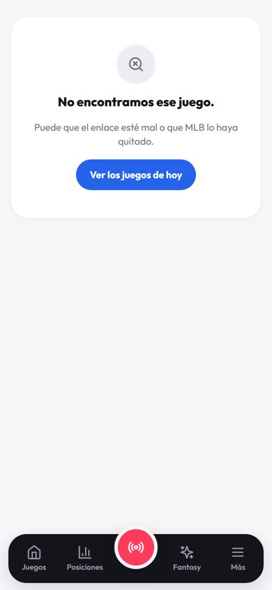
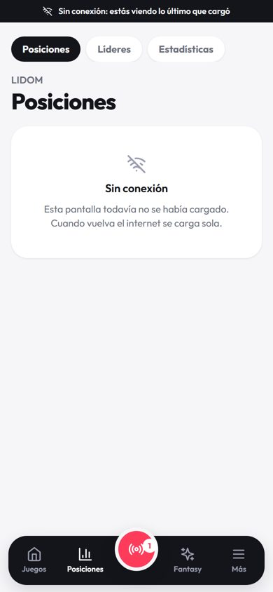
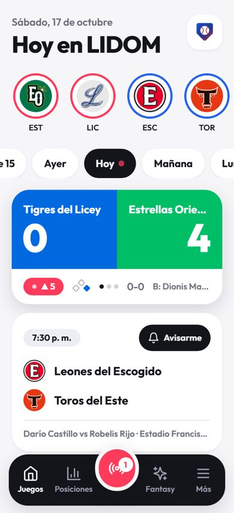
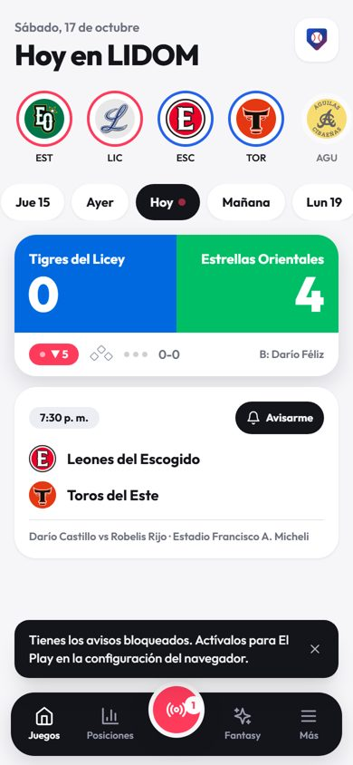
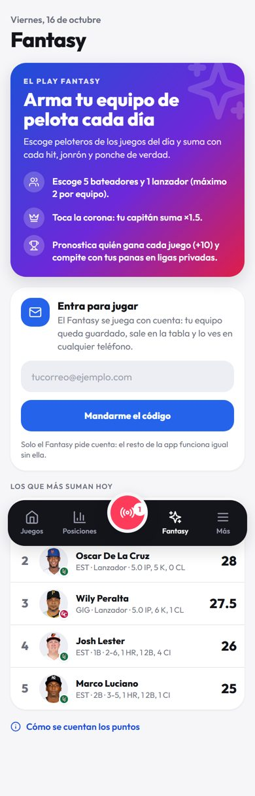
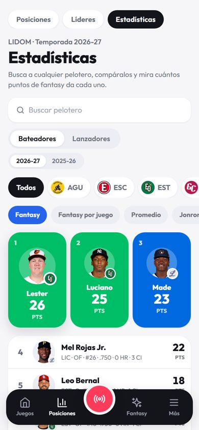
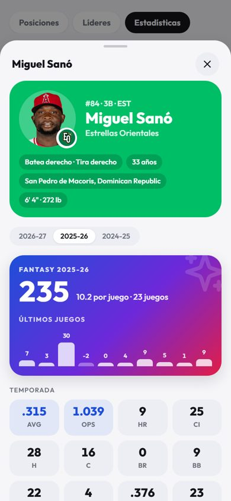

# Prueba de usuario de El Play

**Primera prueba:** viernes 16 de octubre de 2026, primer día de la temporada 2026-27 de LIDOM. Versión: producción, commit `0ea3c30`.
**Re-prueba:** sábado 17 de octubre de 2026, después de arreglar todo lo encontrado y de sumar Fantasy, cuentas y Estadísticas.

## Cómo se probó

- Usé la app como un fanático:
  - Portada, días, filtro por equipo y cambio de liga.
  - Juego en vivo, terminado y por empezar.
  - Zona de strike, jugadas, box score, mapa de batazos y compartir.
  - Posiciones, Líderes, Estadísticas, Fantasy y «Más».
  - Instalar y su tutorial.
- Datos reales de MLB (tres juegos en vivo el 16) y datos simulados (`dev:mock`) para tener siempre un juego en vivo y otro por empezar.
- Teléfonos y pantallas simulados con Playwright: Android con Chrome, iPhone con Safari 26, navegador de Instagram, 320 px (iPhone SE), 390 px y escritorio de 1440 px. También modo claro/oscuro, español/inglés y lectores de pantalla (nombres de botones).
- Pruebas negativas:
  - Enlaces rotos y juegos que no existen.
  - API caída, lenta y con error 500.
  - Sin conexión, con y sin datos ya cargados.
  - Navegador sin almacenamiento.
  - Llamadas directas a la API con datos malos.
  - Avisos bloqueados e iPhone sin instalar.
  - Código de entrada equivocado, límites del Fantasy y búsquedas sin resultados.
- Cuentas: con un Supabase falso en la PC (sin tocar datos reales) y en producción solo hasta la pantalla de entrar. El código del correo lo escribe el dueño de la cuenta.

**Lo que no se pudo probar:**
- Teléfonos de verdad: el «iPhone» es Chrome con la identificación de un iPhone, no Safari real.
- La instalación real en la pantalla de inicio y las notificaciones con permiso concedido.
- Entrar con un correo real en producción: falta que el dueño entre con su correo (o el enlace) y confirme.
- Las animaciones con una jugada real en vivo: se probaron simulando la llegada de cada jugada.

## Resumen

**Primera prueba:** 82 comprobaciones, 72 bien. Los 10 problemas reales están abajo.
**Re-prueba:** los 10 están arreglados (25 de 25 comprobaciones de los arreglos bien, sin errores en la página) y las pantallas nuevas pasaron sus pruebas.

| Prioridad | Problema | Dónde | Estado |
|---|---|---|---|
| Alta | Un juego que no existe se mostraba como una previa vacía | `/juego/999999999` | **Arreglado** |
| Alta | Sin conexión, una pantalla que no habías abierto se quedaba cargando para siempre | Posiciones, Líderes, Estadísticas, Fantasy, juego | **Arreglado** |
| Alta | En pantallas de 320 px la portada se movía de lado | Portada | **Arreglado** |
| Media | «Avisarme» no decía nada si el teléfono bloquea las notificaciones | Juego por empezar | **Arreglado** |
| Media | Decía «la temporada nueva aún no empieza» cuando ya había juegos | Posiciones, Líderes, Estadísticas | **Arreglado** |
| Media | Los enlaces compartidos salían sin imagen ni título | Toda la app | **Arreglado** |
| Media | No se podía hacer zoom | Toda la app | **Arreglado** |
| Baja | Fecha de la previa con mayúscula en cada palabra | Juego por empezar | **Arreglado** |
| Baja | La API respondía una página HTML en rutas que no existen | `/api/v2/...` | **Arreglado** |
| Baja | No había `robots.txt` | SEO | **Arreglado** |

## Qué se arregló y cómo

### 1. Juego que no existe

- **Antes:** «Abridores probables · Por anunciar» como si fuera un juego real. La API respondía `200` con `gamePk: 0`.
- **Ahora:**
  - La API responde `404 game_not_found` cuando MLB devuelve un juego sin equipos.
  - La app dice «No encontramos ese juego» con el botón «Ver los juegos de hoy».
  - `/juego/abc` sigue diciendo que el enlace no es válido.

### 2. Sin conexión en una pantalla nueva

- **Antes:** cuadros grises de carga para siempre.
- **Ahora:**
  - Sale «Sin conexión: esta pantalla todavía no se había cargado. Cuando vuelva el internet se carga sola».
  - Al volver la red, la pantalla carga sin tocar nada (probado).
  - Aplica en Portada, Juego, Posiciones, Líderes, Estadísticas y Fantasy.

### 3. Portada a 320 px

- **Antes:** la portada se pasaba 11 px de la pantalla (37 px con un juego por empezar al lado de uno en vivo).
- **Causa:** la columna de la cuadrícula tomaba el ancho del contenido más largo, y el nombre del bateador no se podía cortar.
- **Ahora:** la columna se ajusta a la pantalla y el nombre se corta con «…». 0 px de desborde en Portada, Estadísticas, Fantasy, Posiciones y Más.

### 4. «Avisarme» con avisos bloqueados

- **Ahora siempre dice qué pasó:**
  - Activado: «Listo: te avisamos cuando empiece».
  - Quitado: «Quitamos el aviso de este juego».
  - Bloqueado: «Tienes los avisos bloqueados. Actívalos para El Play en la configuración del navegador».
  - **iPhone sin instalar:** antes el botón ni salía. Ahora sale y explica que en iPhone los avisos solo funcionan con la app instalada, con el botón «Ver cómo» que abre el tutorial.

### 5. Texto de la temporada

Ahora dice «Todavía no hay juegos terminados de la temporada nueva: estas son las posiciones de la pasada» (igual en Líderes y Estadísticas).

### 6. Vista previa al compartir

- Etiquetas Open Graph y de X/Twitter con título, descripción e imagen de 1200×630 (`public/og-image.jpg`, 53 KB) con el logo y «Béisbol dominicano en vivo, pitcheo a pitcheo».
- Una imagen distinta por juego, con el marcador, queda como idea para más adelante: necesita generarla en el servidor.

### 7. Zoom

- Ya se puede ampliar con dos dedos (box score, jugadas, tablas).
- Solo se evita el zoom por doble toque, que se disparaba sin querer al tocar rápido el marcador.

### 8. Fecha de la previa

Ahora dice «Sáb, 17 oct · 7:30 p. m.»: solo la primera letra en mayúscula.

### 9. API

- Ruta que no existe → `404 {"error":"not_found"}` en JSON.
- Liga que no existe (`?league=zzz`) → `400 invalid_league`. Sin `league` sigue siendo LIDOM.
- **Fotos:** las que MLB no tiene se recuerdan una semana en el teléfono. Así no se vuelven a pedir en cada pantalla y la consola deja de llenarse de `404`. La primera vez de cada pelotero el `404` es inevitable: MLB no dice antes si tiene la foto.

### 10. `robots.txt` y `sitemap.xml`

Archivos reales. La API queda fuera de los buscadores.

## Lo que se pulió

- **Instalar:** antes salían a la vez la tarjeta grande y el ícono de arriba. Ahora la tarjeta sale solo en la primera visita y después queda solo el ícono. Probado con Android: 1.ª visita solo la tarjeta, 2.ª solo el ícono.
- **Instagram en computadora:** al descargar la imagen dice «Se guardó la imagen: súbela desde Instagram en tu teléfono».
- **Tutorial de Android:** detecta Samsung Internet (menú ≡ abajo → «Agregar página a» → «Pantalla de inicio») y Firefox (menú ⋮ → «Instalar»). Chrome sigue igual.
- **Animaciones:** en «Más» hay tres modos:
  - **Grandes** (por defecto): en los juegos de tu equipo favorito salen todas; en los demás, solo jonrones, ponches, fin de entrada y victorias.
  - **Todas**.
  - **Apagadas**.
  - Quien las tenía apagadas las sigue teniendo apagadas.
- **Días vacíos:** ya no salen en el selector los días de antes del primer juego de la temporada («Hoy» siempre sale).
- **Privacidad:** página `/privacidad`, con enlace en «Más» y en la tarjeta de la cuenta. Explica qué se guarda sin cuenta, qué guarda la cuenta del Fantasy (correo, nombre, equipos y ligas en Supabase), que no hay anuncios y cómo borrar la cuenta.
- **Borrar la cuenta:** «Más → Tu cuenta → Borrar mi cuenta», con confirmación. Borra perfil, equipos, pronósticos y ligas creadas. La App Store lo exige para la app móvil.

## Pantallas nuevas probadas (17 de octubre)

### Fantasy y cuentas

| Prueba | Resultado |
|---|---|
| Sin Supabase configurado: el Fantasy dice «abre muy pronto» y no deja jugar | Bien |
| Producción con Supabase: pide entrar con correo | Bien |
| Código equivocado | Bien: «Ese código no sirve o ya venció» |
| Código bueno → entra al Fantasy | Bien |
| Lo armado sin cuenta en la versión anterior pasa a la cuenta | Bien |
| La copia del teléfono es por usuario (dos cuentas en el mismo teléfono no se mezclan) | Bien (prueba automática) |
| Salir de la cuenta → vuelve a pedir entrar | Bien |
| Tercer pelotero del mismo equipo | Bien: «Ya tienes 2 de este equipo» |
| Pelotero cuyo juego empezó | Bien: candado, no se puede agregar ni quitar |
| Pronóstico de un juego que empezó | Bien: bloqueado |
| Tabla del día y nombre para la tabla | Bien |
| Supabase: tablas, permisos y crear liga sin cuenta (debe fallar) | Bien: `not_signed_in` |
| Entrar con el enlace del correo (plantilla de fábrica de Supabase) | Bien: la app toma la sesión del enlace y lo dice |
| 320 px | Bien: 0 px de desborde |

### Estadísticas y ficha del pelotero

 

| Prueba | Resultado |
|---|---|
| 168 peloteros de la temporada (con los del roster que aún no juegan) y 448 de la pasada | Bien |
| Buscar «zzzz» | Bien: «No encontramos a nadie con «zzzz»» |
| Ordenar por AVG: un 1-1 sin turnos suficientes va al final | Bien |
| Cambiar a 2025-26 y abrir la ficha de ese año | Bien |
| Atrás cierra la ficha; un juego del juego a juego abre el juego | Bien |
| Ficha desde Líderes y desde el selector del Fantasy (con botón «Agregar») | Bien |
| Pelotero sin juegos este año: ofrece «Ver la temporada 2025-26» | Bien |
| `/api/v2/player/abc` → 400; `season=xx` → 400 | Bien |
| Modo oscuro y 320 px | Bien |

## Pendiente del dueño (fuera del código)

- **Correo con código y con el estilo de El Play:** Supabase no deja editar las plantillas sin SMTP propio. Conectar Resend (gratis) con grullonb.com o Gmail; los pasos están en la conversación. Mientras tanto el correo de fábrica trae un enlace y la app ya lo acepta.
- **Borrar cuenta:** correr en Supabase la parte nueva de `supabase/fantasy.sql` (función `delete_my_account`).
- **Contacto en la privacidad:** las tiendas de apps piden un correo de contacto. Falta decidir cuál.

## Ideas para la próxima versión

| Idea | Por qué | Esfuerzo |
|---|---|---|
| Avisos de tu equipo aunque la app esté cerrada (push) | Hoy los avisos solo salen con la app abierta | Alto (servidor de push) |
| Imagen por juego al compartir (marcador en la vista previa) | Más clics desde WhatsApp | Medio |
| Calendario de tu equipo con «Agregar al calendario» | Saber cuándo juega sin abrir la app | Bajo |
| Modo «solo mi equipo» en la portada | Menos ruido para el fanático de un equipo | Bajo |
| Validar el cierre de cada pelotero del Fantasy en el servidor | Hoy lo cuida la app; alguien con conocimientos podría cambiar su equipo después de empezar un juego | Medio |
