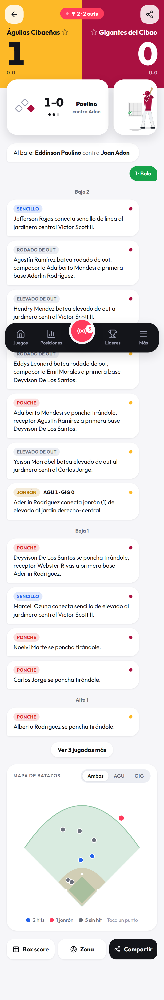
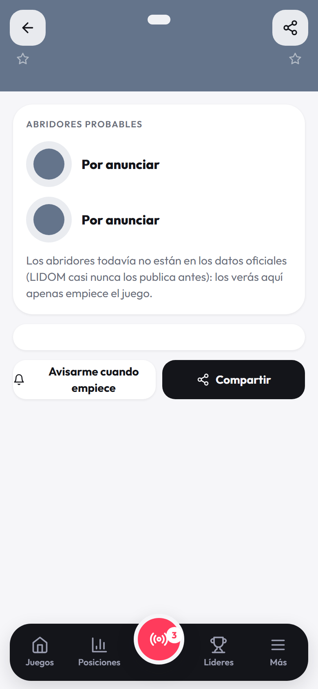
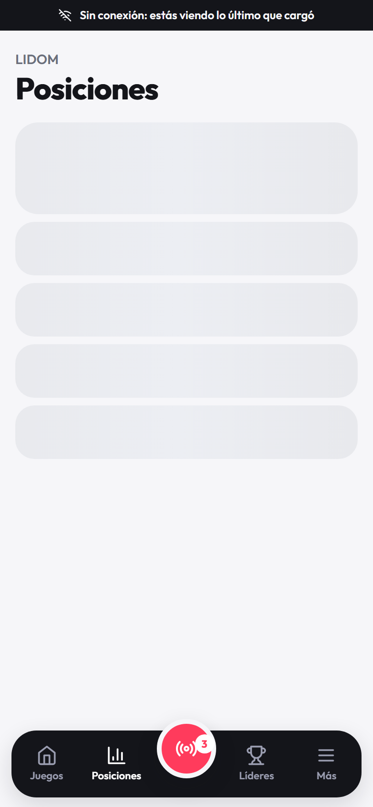
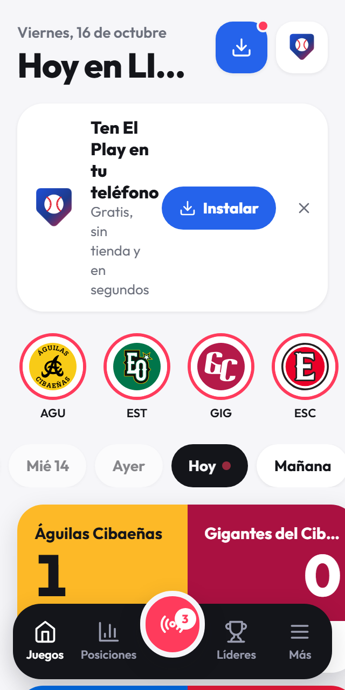
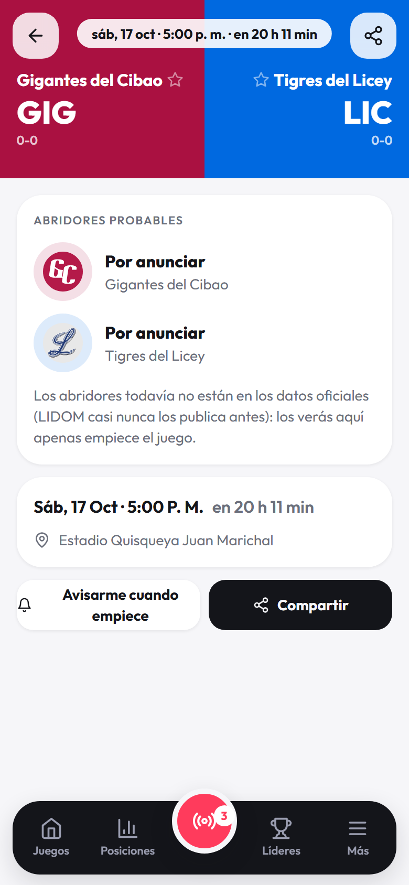
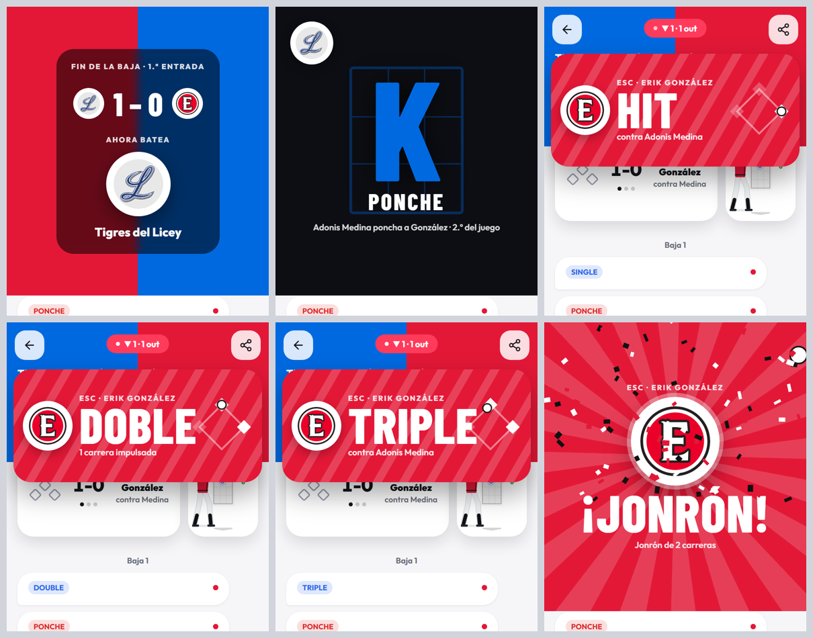

# Prueba de usuario de El Play

**Fecha:** viernes 16 de octubre de 2026, noche del primer día de la temporada 2026-27 de LIDOM.
**Versión probada:** producción (el-play.vercel.app), commit `0ea3c30`.

## Cómo se probó

- Usé la app como un fanático:
  - Portada, días, filtro por equipo y cambio de liga.
  - Juego en vivo, terminado y por empezar.
  - Zona de strike, jugadas, box score, mapa de batazos y compartir.
  - Posiciones, Líderes y «Más».
  - Instalar y su tutorial.
- Hubo tres juegos reales en vivo: Águilas–Gigantes (Julián Javier, sin rastreo), Licey–Escogido (Quisqueya) y Estrellas–Toros (Micheli).
- Teléfonos y pantallas simulados con Playwright: Android con Chrome, iPhone con Safari 26, navegador de Instagram, 320 px (iPhone SE), 390 px y escritorio de 1440 px. También modo claro/oscuro, español/inglés y lectores de pantalla (nombres de botones).
- Pruebas negativas:
  - Enlaces rotos.
  - API caída, lenta y con error 500.
  - Sin conexión.
  - Navegador sin almacenamiento.
  - Llamadas directas a la API con datos malos.

**Lo que no se pudo probar:**
- Teléfonos de verdad: el «iPhone» es Chrome con la identificación de un iPhone, no Safari real.
- La instalación real en la pantalla de inicio.
- Las notificaciones con permiso concedido.
- Las animaciones con una jugada real en vivo: se probaron simulando la llegada de cada jugada. Las verás en el próximo hit, ponche o cambio de entrada.

## Resumen

82 comprobaciones: 72 bien y 10 marcadas mal. De esas 10, 4 eran fallos de mi script (no de la app) y 1 es una decisión tuya (el zoom). Quedan los problemas reales de abajo, más otros que encontré mirando las pantallas.

| Prioridad | Problema | Dónde |
|---|---|---|
| Alta | Un juego que no existe se muestra como una previa vacía | `/juego/999999999` |
| Alta | Sin conexión, una pantalla que no habías abierto se queda cargando para siempre | Posiciones, Líderes |
| Alta | En pantallas de 320 px la portada se mueve de lado | Tarjeta del juego en vivo |
| Media | «Avisarme» no dice nada si el teléfono bloquea las notificaciones | Juego por empezar |
| Media | Dice «la temporada nueva aún no empieza» cuando ya hay juegos | Posiciones, Líderes |
| Media | Los enlaces compartidos salen sin imagen ni título en WhatsApp/Facebook | Toda la app |
| Media | No se puede hacer zoom (decisión del 12 de octubre) | Toda la app |
| Baja | Fecha de la previa con mayúscula en cada palabra | Juego por empezar |
| Baja | La API responde una página HTML en rutas que no existen | `/api/v2/...` |
| Baja | No hay `robots.txt` (devuelve la app) | SEO |

## Lo que funciona bien

- **Rápida:** la portada pinta en ~0,5 s (primer contenido 472 ms) con 24 peticiones, aun desde la red de la oficina.
- **Juego en vivo completo:**
  - Marcador, situación, zona de strike con la ubicación del anotador en el estadio sin rastreo.
  - Jugadas en español («Sencillo», «Ponche», «Jonrón»), mapa de batazos, box score y hoja de compartir.
- **Juego terminado:**
  - El resumen tipo historia funciona («Grand slam de Enmanuel Valdez», figuras, decisiones).
  - El título de la pestaña cambia a «EST 6-5 ESC · El Play».
- **Errores bien manejados:**
  - API con 500 o sin red muestra un mensaje y el botón «Reintentar».
  - API lenta muestra esqueletos de carga.
  - `/juego/abc` dice «El enlace del juego no es válido».
  - Rutas viejas (`/game/...`) y rutas inventadas llevan a donde deben.
- **Sin conexión con datos ya cargados:** sale el aviso «Sin conexión: estás viendo lo último que cargó» y se siguen viendo los juegos.
- **Navegador sin almacenamiento** (modo privado estricto): la app carga igual.
- **Instalar:**
  - El ícono arriba solo sale si no está instalada.
  - `/instalar` detecta iPhone, Android, Instagram y computadora, y muestra la guía correcta.
- **Compartir en computadora:** WhatsApp y Facebook abren con el texto y el enlace del juego.
- **Equipo favorito:** se guarda al recargar y su juego sale primero en la portada.
- **Inglés y modo oscuro:** se aplican en toda la app; no quedan textos en español en la portada en inglés.
- **Accesibilidad básica:** todos los botones tienen nombre, todas las imágenes tienen `alt` y el foco se ve con el teclado.
- **Sin desborde:** a 390 px y en escritorio, ninguna pantalla se mueve de lado.

## Problemas encontrados

### 1. Un juego que no existe se muestra como una previa vacía (alta)

- **Cómo reproducir:** abre `el-play.vercel.app/juego/999999999`.
- **Qué pasa:** sale «Abridores probables · Por anunciar · Por anunciar» y la nota de los abridores, como si fuera un juego real sin equipos. La API responde `200` con `gamePk: 0` y `detailedState: "Unknown"`.
- **Qué esperaba:** «No encontramos ese juego» y un botón para volver a los juegos de hoy.
- **Propuesta:**
  - En el servidor, si el juego de MLB viene sin equipos, responder `404 game_not_found`; la app ya sabe mostrar ese error.
  - Proteger la pantalla para que no pinte una previa si faltan los equipos.

### 2. Sin conexión, las pantallas que no habías abierto se quedan cargando para siempre (alta)

- **Cómo reproducir:** abre la portada, quita el internet y toca «Posiciones».
- **Qué pasa:** se queda con los cuadros grises de carga sin decir nada, aunque arriba diga «Sin conexión».
- **Qué esperaba:** «Sin conexión: esta pantalla todavía no se había cargado. Conéctate y desliza para recargar».
- **Propuesta:** si la consulta está pausada por falta de red y no tiene datos, mostrar ese mensaje en lugar del esqueleto. Pasa en Posiciones, Líderes y en un juego que nunca abriste.

### 3. En pantallas de 320 px la portada se mueve de lado (alta)

- **Cómo reproducir:** portada en un teléfono de 320 px de ancho (iPhone SE, Android pequeños) con un juego en vivo.
- **Qué pasa:** la tarjeta del juego en vivo mide 331 px, 11 px más que la pantalla, y la página se puede arrastrar de lado.
- **Propuesta:** dejar que el nombre del equipo se corte o achique en la tarjeta en vivo (`min-width: 0` y `truncate` en la fila del nombre) y revisar el ancho fijo de la cajita del conteo.

### 4. «Avisarme» no dice nada si el teléfono bloquea las notificaciones (media)

- **Cómo reproducir:** en un juego por empezar toca «Avisarme cuando empiece» con las notificaciones bloqueadas.
- **Qué pasa:** el botón no cambia y no aparece ningún mensaje.
- **Propuesta:**
  - Mostrar «Activa las notificaciones de El Play en la configuración del navegador».
  - En iPhone, decir que los avisos solo funcionan con la app instalada, con un enlace al tutorial.

### 5. «La temporada nueva aún no empieza» cuando ya hay juegos (media)

- **Qué pasa:** hoy, con tres juegos en vivo, Posiciones y Líderes dicen que la temporada no ha empezado y muestran la 2025-26.
- **Propuesta:** el texto debería ser «Todavía no hay juegos terminados de la 2026-27: estos son los de la temporada pasada». A partir de mañana se arregla solo, cuando MLB tenga posiciones de la temporada nueva.

### 6. Los enlaces compartidos salen sin imagen ni título (media)

- **Qué pasa:** la página no tiene etiquetas Open Graph. En WhatsApp y Facebook el enlace sale pelado, sin la imagen del juego ni el marcador. Ahora que hay botones de WhatsApp y Facebook, esto se nota más.
- **Propuesta:**
  - Etiquetas `og:title`, `og:description` y `og:image` generales con el logo.
  - Más adelante, una imagen por juego con el marcador generada en el servidor.

### 7. No se puede hacer zoom (media, decisión tuya)

- Desde el 12 de octubre la app bloquea el zoom (`maximum-scale=1, user-scalable=no`) para que se sienta como app.
- Quien ve poco no puede ampliar el box score ni las jugadas, y las reglas de accesibilidad piden permitirlo.
- **Propuesta:** permitir el zoom y mantener el bloqueo solo del doble toque.

### 8. Fecha de la previa con mayúscula en cada palabra (baja)

- **Qué pasa:** en los detalles del juego por empezar dice «Sáb, 17 Oct · 5:00 P. M.» porque a todo el renglón se le aplica `capitalize`.
- **Propuesta:** solo la primera letra en mayúscula, como en la cabecera («sáb, 17 oct · 5:00 p. m.»).

### 9. Detalles de la API (baja)

- `/api/v2/<algo que no existe>` responde la página HTML de Express («Cannot GET») en lugar de `{"error":"not_found"}`.
- `/api/v2/schedule?league=zzz` devuelve LIDOM sin avisar. Para la app está bien; si algún día la API es pública, mejor un `400`.
- La consola muestra `404` de fotos: es el respaldo de MLB a MiLB funcionando. No afecta al usuario, pero ensucia la consola.
- `robots.txt` y `sitemap.xml` devuelven la app. Conviene un `robots.txt` real.

## Lo que funciona pero se puede pulir

- **Dos llamados a instalar en la portada:** la tarjeta «Ten El Play en tu teléfono» y el ícono azul de arriba piden lo mismo. Propongo dejar solo el ícono una vez que la persona cierre la tarjeta (ya pasa 14 días) o desde la segunda visita.
- **Instagram en computadora:** el botón descarga la imagen sin decir nada. Mejor un mensaje: «Se guardó la imagen: súbela desde Instagram en tu teléfono».
- **Tutorial de Android:** los pasos son los de Chrome. En Samsung Internet y Firefox el menú cambia; se puede detectar el navegador como ya se hace en iPhone.
- **Animaciones:** salen con cada hit, así que en una entrada de muchos hits pueden cansar.
  - Opción: solo jonrón, ponche y fin de entrada para los juegos de otros equipos, y todas para tu equipo favorito.
  - Ya se pueden apagar en «Más».
- **Días sin juegos en el selector:** «Mar 13», «Mié 14» y «Ayer» no tienen juegos (la temporada empezó hoy). Se podrían esconder los días vacíos antes del primer juego.
- **Página de privacidad:** está en la rama `feat/banners-publicidad`, no en producción. Conviene subirla sola aunque los anuncios esperen.

## Ideas para la próxima versión

| Idea | Por qué | Esfuerzo |
|---|---|---|
| Avisos de tu equipo favorito aunque la app esté cerrada (notificaciones push) | Hoy los avisos solo salen con la app abierta | Alto (servidor de push) |
| Imagen del juego en los enlaces compartidos (Open Graph por juego) | Más clics desde WhatsApp | Medio |
| Página de cada pelotero (foto, temporada, últimos juegos) | Hoy los nombres no llevan a ningún lado | Medio |
| Calendario de tu equipo con «Agregar al calendario» | Saber cuándo juega sin abrir la app | Bajo |
| Modo «solo mi equipo» en la portada | Menos ruido para el fanático de un equipo | Bajo |

## Detalle de las pruebas

| Área | Prueba | Resultado |
|---|---|---|
| Portada | Carga hasta ver los juegos | Bien (670 ms) |
| Portada | Fecha, liga, ícono y tarjeta de instalar | Bien |
| Portada | Juegos del día (3 en vivo) | Bien |
| Portada | Días «Ayer» y «Mañana» | Bien («No hay juegos este día» ayer; 3 juegos mañana) |
| Portada | Filtrar por equipo | Bien (queda 1 juego) |
| Portada | Cambiar a Serie del Caribe | Bien |
| Portada | 320 px | **Mal**: se mueve 9–11 px de lado |
| Juego en vivo | Marcador, zona, jugadas, box score, mapa, compartir | Bien |
| Juego terminado | Historia, diapositivas, jugadas, título de la pestaña | Bien |
| Juego por empezar | Previa, «Avisarme», equipo favorito | Bien, salvo «Avisarme» sin aviso |
| Posiciones | Serie regular, Round Robin, Serie final | Bien |
| Líderes | Categorías y fotos (MLB 7, Toros 2, MiLB 1) | Bien |
| Más | Instalar, paso a paso, animaciones, tema oscuro, inglés | Bien |
| Instalar | iPhone Safari, Instagram, computadora | Bien |
| Negativa | `/juego/999999999` | **Mal**: previa vacía |
| Negativa | `/juego/abc`, `/game/...`, `/no-existe`, `/juego/` | Bien |
| Negativa | API con 500 / sin red / lenta | Bien |
| Negativa | Sin conexión con datos cargados | Bien |
| Negativa | Sin conexión en pantalla nueva | **Mal**: carga infinita |
| Negativa | Navegador sin almacenamiento | Bien |
| Negativa | Escritorio 1440 px | Bien |
| API | `game/abc` → 400, `photos/../..` → 404 | Bien |
| API | `game/999999999` → 200 | **Mal**: debería ser 404 |
| Accesibilidad | Nombres de botones, `alt`, foco visible | Bien |
| Accesibilidad | Zoom | Bloqueado (decisión) |
